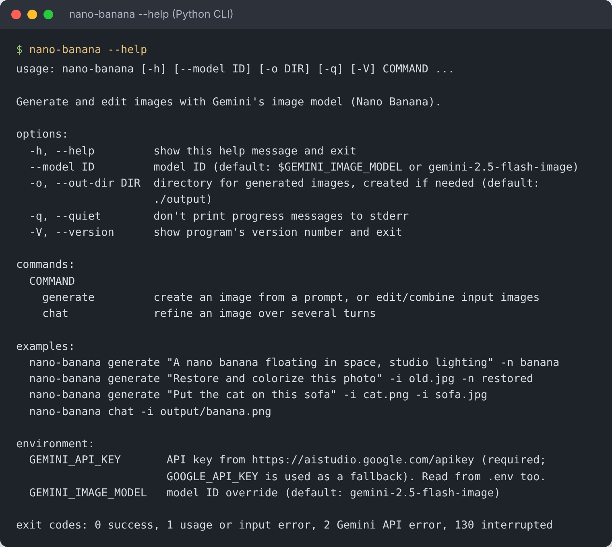
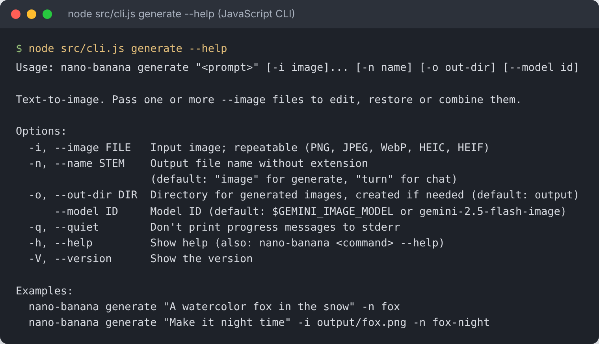
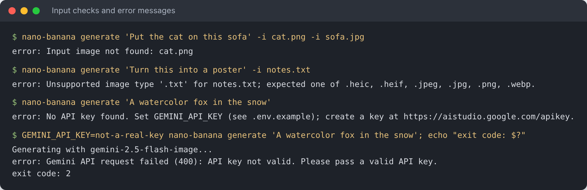
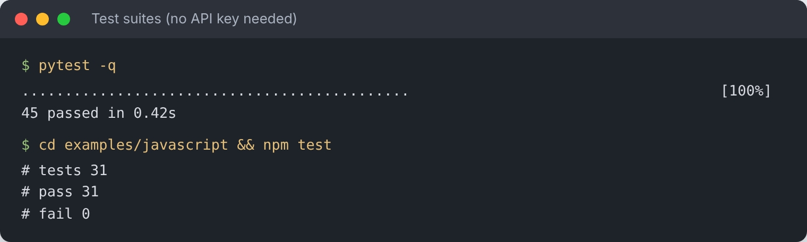
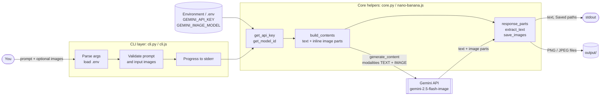

<p align="center">
  
</p>

<h1 align="center">Nano Banana Hackathon Kit</h1>

<p align="center">
  <strong>Guides, notebooks and tested Python + JavaScript CLIs for generating and editing images with Gemini 2.5 Flash Image ("Nano Banana").</strong>
</p>

<p align="center">
  
  
  
  
  
</p>

---

## Overview

**What it is.** A starter kit for building with **Gemini 2.5 Flash Image**, the Gemini API
model nicknamed "Nano Banana". It can create an image from text, edit an existing image with
a sentence, restore old photos, combine several pictures, and refine a result over several
conversational turns.

**Where it comes from.** It began as the official resource hub for the
[Nano Banana 48 Hour Challenge](https://www.kaggle.com/competitions/banana), hosted by Google
DeepMind on Kaggle in September 2025. This fork keeps those guides and fixes them. The
hackathon-era samples had all stopped working because their preview model ID was retired.
The fork also adds small, tested helper libraries and command-line tools in Python and
JavaScript that you can run straight away or copy into your own project.

**Who it is for.**

- **Hackathon teams and prototypers** who want a working image pipeline in minutes, not hours.
- **Developers new to the Gemini API** who want a guided, notebook-first introduction.
- **App builders** who want a small, well-tested wrapper (key handling, MIME types, saving
  every returned image, readable errors) to copy rather than write from scratch.

> [!NOTE]
> The challenge ended on September 7, 2025, and its free 48-hour API tier is no longer
> available. Everything here works with a regular Gemini API key. The original competition
> details are kept [at the end](#-the-original-challenge) for reference.

## Contents

- [Screenshots](#screenshots)
- [Features](#features)
- [Tech stack](#tech-stack)
- [Architecture](#architecture)
- [Project structure](#project-structure)
- [Prerequisites](#prerequisites)
- [Installation](#installation)
- [Configuration](#configuration)
- [Running it](#running-it)
- [Usage](#usage)
  - [Notebooks](#notebooks-walkthrough)
  - [CLI reference](#cli-reference)
  - [CLI examples](#cli-examples)
  - [Library API (Python)](#library-api-python)
  - [Library API (JavaScript)](#library-api-javascript)
- [Scripts and commands](#scripts-and-commands)
- [Testing](#testing)
- [Linting and formatting](#linting-and-formatting)
- [Deployment: using it in your own project](#deployment-using-it-in-your-own-project)
- [Troubleshooting and FAQ](#troubleshooting-and-faq)
- [Known limitations](#known-limitations)
- [Roadmap ideas](#roadmap-ideas)
- [Contributing](#contributing)
- [Resources](#resources)
- [The original challenge](#-the-original-challenge)
- [Credits and license](#credits-and-license)

## Screenshots

These are real terminal captures of the CLIs in this repository (see
[`docs/screenshots/`](./docs/screenshots/)). No API key was used to make them, so they show
help output, input checks, error handling and the test suites, not generated images.

<table>
  <tr>
    <td width="50%" valign="top">
      <strong>Python CLI help</strong> (<code>nano-banana --help</code>)<br>
      
    </td>
    <td width="50%" valign="top">
      <strong>JavaScript CLI command help</strong> (<code>generate --help</code>)<br>
      
    </td>
  </tr>
  <tr>
    <td width="50%" valign="top">
      <strong>Input checks and error messages</strong><br>
      
    </td>
    <td width="50%" valign="top">
      <strong>Offline test suites</strong><br>
      
    </td>
  </tr>
</table>

## Features

**Guides**

- 📓 **[01 · Getting your API key](./guides/01-getting-your-api-key.ipynb).** Create a key in
  AI Studio, install the SDK and generate your first image.
- 📓 **[02 · Using Nano Banana](./guides/02-use-nano-banana.ipynb).** Text-to-image, image
  editing, multi-image stories, chat-based iteration and mixing several pictures.
- 📄 **[JavaScript/TypeScript guide](./examples/javascript-getting-started.md).** Copy-paste
  snippets for generation, editing, photo restoration, multiple inputs and conversational
  editing.
- Both notebooks run in **Google Colab** (with a Colab Secret) or **locally** (with an
  environment variable). No key is ever pasted into code.

**Command-line tools** (the Python and JavaScript versions behave the same way)

- `generate` creates an image from a prompt. Add `--image` (repeatable) to edit, restore or
  combine existing images.
- `chat` is an interactive, multi-turn session. Each turn's result is saved as
  `turn-1.png`, `turn-2.png`, and so on, and a blocked turn doesn't end the session.
- **Every returned image is saved.** If a response contains several images, they are numbered
  so none overwrites another.
- **Fails fast and clearly.** A missing or unsupported input image, an empty prompt or a
  missing key is reported *before* any network call. API errors show Google's readable
  message, and a 404 suggests checking the model ID.
- **Script-friendly.** Results go to stdout and progress to stderr. `--quiet` silences
  progress, and exit codes are distinct (`0` ok, `1` input, `2` API, `130` interrupted).
- `--help` on every command (with examples), `--version`, and global options such as
  `--model` and `--out-dir` accepted before or after the subcommand.
- Input MIME types are detected from the file extension (PNG, JPEG, WebP, HEIC, HEIF).

**Engineering**

- Configured **only through environment variables** (`.env` supported). Keys never live in code.
- **76 offline tests** (45 pytest + 31 `node:test`) using a mocked client, so no key or
  network is needed.
- Ruff (lint + format, including the notebooks), ESLint and Prettier. The JavaScript is
  type-checked with `// @ts-check`.

## Tech stack

| Area           | Technology                                                                                                                                  |
| -------------- | ------------------------------------------------------------------------------------------------------------------------------------------- |
| Model          | Gemini 2.5 Flash Image (`gemini-2.5-flash-image`) via the [Gemini API](https://ai.google.dev/gemini-api/docs/image-generation)              |
| Python library | Python 3.10+, [`google-genai`](https://pypi.org/project/google-genai/) ≥ 1.32, [`python-dotenv`](https://pypi.org/project/python-dotenv/) |
| Python tooling | setuptools (packaging), pytest, Ruff                                                                                                        |
| JS library     | Node.js 22.9+, ES modules, [`@google/genai`](https://www.npmjs.com/package/@google/genai) ^3.3                                              |
| JS tooling     | `node:test`, ESLint 10 (flat config), Prettier 3, JSDoc types with `// @ts-check`                                                           |
| Notebooks      | Jupyter / Google Colab, Pillow, IPython display                                                                                             |

## Architecture

Both implementations share one design: a thin **CLI layer** (arguments, I/O, exit codes) on
top of a **core helper module** that is pure apart from the single API call. That split is
what lets the whole test suite run offline.



Request lifecycle for `nano-banana generate "..." -i photo.jpg`:

1. **Load config.** The `.env` file is loaded (Python: nearest one from the working directory
   upwards; JavaScript: the repo-root `.env` when started through `npm start`).
2. **Validate locally.** The prompt must be non-empty, and each `--image` must exist and have a
   supported extension. Failures exit with code `1` and no API call is made.
3. **Create the client** from `GEMINI_API_KEY` (or `GOOGLE_API_KEY`).
4. **Build contents:** the text part first, then each image as base64 inline data with the
   right MIME type.
5. **Call the API** (`models.generate_content` / `chats.send_message`) with
   `response_modalities = ["TEXT", "IMAGE"]`.
6. **Handle the response.** If there are no parts, an `EmptyResponseError` explains why
   (block reason or finish reason). Otherwise the text parts are printed (thought summaries
   are skipped) and every inline image is written to `--out-dir`.

## Project structure

```
.
├── assets/
│   └── header.png                     # README banner (from upstream)
├── docs/
│   └── screenshots/                   # real terminal captures used in this README
├── guides/
│   ├── 01-getting-your-api-key.ipynb  # create a key, install the SDK, first image
│   └── 02-use-nano-banana.ipynb       # generate, edit, stories, chat, mix pictures
├── examples/
│   ├── javascript-getting-started.md  # JS/TS snippets (each one runs as-is)
│   ├── python/
│   │   ├── nano_banana/
│   │   │   ├── __init__.py            # public API + __version__ (single source of truth)
│   │   │   ├── __main__.py            # enables `python -m nano_banana`
│   │   │   ├── core.py                # pure helpers: config, MIME, contents, response handling
│   │   │   └── cli.py                 # argparse CLI: generate / chat, exit codes
│   │   └── tests/
│   │       ├── test_core.py           # helpers, with real google.genai response types
│   │       └── test_cli.py            # CLI behaviour with a mocked client
│   └── javascript/
│       ├── src/
│       │   ├── nano-banana.js         # pure helpers (mirror of core.py)
│       │   └── cli.js                 # CLI: generate / chat, exit codes
│       ├── test/                      # node:test suites
│       ├── eslint.config.js           # ESLint flat config
│       ├── .prettierrc.json           # Prettier settings
│       ├── package.json               # scripts, bin entry, engines
│       └── package-lock.json
├── .allstar/branch_protection.yaml    # upstream repository policy config
├── .env.example                       # template for your .env
├── .gitignore
├── pyproject.toml                     # Python package, pytest and Ruff config
├── LICENSE                            # Apache License 2.0 (upstream)
└── README.md
```

## Prerequisites

| You need                     | For                         | Notes                                                                                                                   |
| ---------------------------- | --------------------------- | ----------------------------------------------------------------------------------------------------------------------- |
| A **Gemini API key**         | Everything that calls Gemini | Free to create at [aistudio.google.com/apikey](https://aistudio.google.com/apikey). Image output may require billing.   |
| **Python 3.10+** and `pip`   | Python CLI/library, notebooks | `python3 --version`                                                                                                    |
| **Node.js 22.9+** and `npm`  | JavaScript CLI/library      | `node --version`. 22.9 is the first version with `--env-file-if-exists`.                                                |
| **Jupyter** (optional)       | Running notebooks locally   | `pip install jupyterlab pillow`. Not needed in Colab.                                                                        |
| **git**                      | Cloning                     |                                                                                                                         |

No API key is needed to install, lint or run the tests.

## Installation

### 1. Clone the repository

```bash
git clone https://github.com/jeevithg090/nano-banana-hackathon-kit.git
cd nano-banana-hackathon-kit
```

### 2. Add your API key

```bash
cp .env.example .env
# open .env and set GEMINI_API_KEY=your-key-here
```

`.env` is git-ignored. Alternatively, `export GEMINI_API_KEY=...` in your shell.

### 3a. Python (CLI + library)

```bash
python3 -m venv .venv
source .venv/bin/activate          # Windows: .venv\Scripts\activate
pip install -e .                   # add ".[dev]" for pytest and Ruff
nano-banana --version              # → nano-banana 0.1.0
```

### 3b. JavaScript (CLI + library)

```bash
cd examples/javascript
npm ci                             # installs exactly what package-lock.json pins
npm start -- --version             # → nano-banana 0.1.0
```

Optional: run `npm install -g .` (inside `examples/javascript`) to put a global
`nano-banana` command on your PATH. A global install does **not** load `.env`, so export
`GEMINI_API_KEY` in your shell. If you also installed the Python CLI, the two commands share a
name, and whichever comes first on your PATH wins.

### 3c. Notebooks

- **Colab:** click the "Open in Colab" badge at the top of a notebook, then add your key as a
  Colab Secret named `GOOGLE_API_KEY` (🔑 icon in the left sidebar) and allow notebook access.
- **Locally:** `pip install jupyterlab pillow`, `export GEMINI_API_KEY=...`, then
  `jupyter lab guides/`. Each notebook's first code cell installs `google-genai`.

## Configuration

All configuration is through environment variables. Variables already exported in your shell
take precedence over `.env`.

| Variable             | Required | Default                  | Used by               | Description                                                                                       |
| -------------------- | -------- | ------------------------ | --------------------- | ------------------------------------------------------------------------------------------------- |
| `GEMINI_API_KEY`     | **Yes**  | none                     | CLIs, libraries, notebooks | Gemini API key from AI Studio.                                                               |
| `GOOGLE_API_KEY`     | No       | none                     | CLIs, libraries, notebooks | Fallback key, used only if `GEMINI_API_KEY` is empty. Also the Colab Secret name the notebooks read. |
| `GEMINI_IMAGE_MODEL` | No       | `gemini-2.5-flash-image` | CLIs, libraries       | Image model ID. Change it to try a newer image model without editing code. `--model` overrides it. |

**How `.env` is loaded**

| Entry point                                    | `.env` behaviour                                                                 |
| ---------------------------------------------- | -------------------------------------------------------------------------------- |
| `nano-banana` (Python)                         | Searches the working directory and its parents (`python-dotenv`).                |
| `npm start -- ...` (JavaScript)                | Loads the repo-root `.env` if present (`node --env-file-if-exists=../../.env`).  |
| `node src/cli.js`, or a global `nano-banana` (JS) | Does not load `.env`. Export the variables, or add `--env-file=.env` yourself. |
| Notebooks                                      | Colab Secret `GOOGLE_API_KEY` in Colab; `GEMINI_API_KEY`/`GOOGLE_API_KEY` env vars locally. |

> [!IMPORTANT]
> The `gemini-2.5-flash-image-preview` model ID used during the hackathon has been retired,
> so the examples default to the generally available `gemini-2.5-flash-image`. Google retires
> model versions over time. If you get a **404 "model not found"**, check the
> [Gemini API models page](https://ai.google.dev/gemini-api/docs/models) and the
> [deprecations page](https://ai.google.dev/gemini-api/docs/deprecations), then set
> `GEMINI_IMAGE_MODEL`.

## Running it

There is no server to start. "Running" means using the CLIs, the notebooks or the libraries.

| Mode              | Python                                                    | JavaScript                                                   |
| ----------------- | --------------------------------------------------------- | ------------------------------------------------------------ |
| Development       | `pip install -e ".[dev]"`, then `nano-banana ...` (code changes apply immediately) | `npm ci`, then `npm start -- ...` or `node src/cli.js ...`  |
| Regular install   | `pip install .` (or `pip install git+https://github.com/jeevithg090/nano-banana-hackathon-kit`) | `npm install -g .` in `examples/javascript`  |
| As a module       | `python -m nano_banana generate "..."`                    | n/a                                                          |

Generated images go to `./output/` (relative to where you run the command) unless you pass
`-o/--out-dir`.

## Usage

### Notebooks walkthrough

| Notebook | What you do |
| --- | --- |
| [`01-getting-your-api-key.ipynb`](./guides/01-getting-your-api-key.ipynb) | **Step 1:** create a key in AI Studio · **Step 2:** install the Python (`google-genai`, Pillow) or JS (`@google/genai`) SDK · **Step 3:** "Hello, Banana!", your first generated image. |
| [`02-use-nano-banana.ipynb`](./guides/02-use-nano-banana.ipynb) | **Setup** (SDK, key, client, model, display helpers) · **Generate images** · **Edit images** · **Get multiple images** (a short illustrated story) · **Chat mode** (iterative edits, the recommended method) · **Mix multiple pictures** · links to docs and AI Studio apps. |

### CLI reference

Both CLIs accept the same commands and options.

```
nano-banana [global options] <command> [command options]
```

| Command                    | Purpose                                                              |
| -------------------------- | -------------------------------------------------------------------- |
| `generate "<prompt>"`      | One request: text-to-image, or edit/combine the `--image` files.     |
| `chat`                     | Interactive. Type one instruction per line; an empty line or Ctrl-D quits. |

| Option                | Applies to       | Default                                     | Description                                                       |
| --------------------- | ---------------- | ------------------------------------------- | ----------------------------------------------------------------- |
| `-i, --image FILE`    | generate, chat   | none                                        | Input image, repeatable. In `chat` it is sent with the first message only. |
| `-n, --name STEM`     | generate, chat   | `image` (generate), `turn` (chat)           | Output file name without extension. Chat appends `-<turn>`.       |
| `-o, --out-dir DIR`   | all              | `output`                                    | Where images are saved. Created if missing.                       |
| `--model ID`          | all              | `$GEMINI_IMAGE_MODEL` or `gemini-2.5-flash-image` | Model to call.                                              |
| `-q, --quiet`         | all              | off                                         | Don't print progress to stderr.                                   |
| `-h, --help`          | all              |                                             | Help. `nano-banana <command> --help` shows command help.          |
| `-V, --version`       | top level        |                                             | Print the version.                                                |

**Output files.** One image is saved as `<stem>.<ext>`. Several images in one response are
saved as `<stem>-1.<ext>`, `<stem>-2.<ext>`, and so on. The extension follows the returned
MIME type (usually `.png`). Existing files with the same name are overwritten, so use `-n` to
keep variants.

**Exit codes**

| Code  | Meaning                                                                                       |
| ----- | --------------------------------------------------------------------------------------------- |
| `0`   | Success (even if the model replied with text only; a note is printed).                         |
| `1`   | Usage or input error: bad arguments, empty prompt, missing/unsupported image, no API key, blocked prompt. |
| `2`   | The Gemini API rejected the request (invalid key, quota, unknown model, ...).                 |
| `130` | Interrupted with Ctrl-C.                                                                      |

### CLI examples

Use `nano-banana` for the Python CLI. With the JavaScript CLI, run `npm start --` from
`examples/javascript` instead; the arguments are the same.

```bash
# Text to image
nano-banana generate "A nano banana floating in space, studio lighting" -n banana

# Edit an image you already have
nano-banana generate "Show this cat walking down a New York sidewalk" -i output/cat.png -n cat-nyc

# Restore an old photo (JPEG is sent with the correct image/jpeg MIME type)
nano-banana generate "Restore and colorize this image from 1932" -i lunch.jpg -n restored

# Combine several images
nano-banana generate "Make the girl wear this t-shirt. Keep the background." -i girl.png -i tshirt.png

# Choose a model and output folder; options work before or after the command
nano-banana generate "A watercolor fox in the snow" --model gemini-2.5-flash-image -o renders

# Use in scripts: no progress output, and branch on the exit code
if nano-banana -q generate "A pixel-art banana" -n sprite; then echo "ok"; fi
```

A successful `generate` prints progress to stderr, then any text from the model followed by
the saved paths on stdout:

```text
Generating with gemini-2.5-flash-image...
<optional text the model returned>
Saved output/banana.png
```

**Multi-turn chat**

```text
$ nano-banana chat -i output/cat.png
Chatting with gemini-2.5-flash-image. Type an instruction per line; empty line or Ctrl-D to quit.
you> Change the cat to a bengal cat, leave everything else the same
Working...
Saved output/turn-1.png
you> Give it a funny party hat
Working...
Saved output/turn-2.png
you>
```

If the model blocks a turn, the CLI prints `error: The model returned no content: prompt
blocked (...)` and keeps the session open so you can rephrase.

**Error output** (from the screenshot above; these are real messages):

```text
$ nano-banana generate 'Put the cat on this sofa' -i cat.png -i sofa.jpg
error: Input image not found: cat.png

$ nano-banana generate 'Turn this into a poster' -i notes.txt
error: Unsupported image type '.txt' for notes.txt; expected one of .heic, .heif, .jpeg, .jpg, .png, .webp.

$ GEMINI_API_KEY=not-a-real-key nano-banana generate 'A watercolor fox in the snow'
Generating with gemini-2.5-flash-image...
error: Gemini API request failed (400): API key not valid. Please pass a valid API key.
```

### Library API (Python)

Install the package (`pip install -e .` from the repo root, or
`pip install git+https://github.com/jeevithg090/nano-banana-hackathon-kit`), then:

```python
from nano_banana import create_client, generate

client = create_client()  # reads GEMINI_API_KEY / GOOGLE_API_KEY
result = generate(
    client,
    "Make this photo look like a 1970s film still",
    ["input.jpg"],  # optional input images
    out_dir="output",
    stem="retro",
)
print(result.text)  # text parts, joined
print(result.image_paths)  # (PosixPath('output/retro.png'),)
```

| Function / class                                   | Description                                                                         |
| -------------------------------------------------- | ----------------------------------------------------------------------------------- |
| `create_client(api_key=None)`                      | `genai.Client`; reads the key from the environment if not given.                    |
| `generate(client, prompt, image_paths=(), *, model, out_dir, stem)` | One request; returns `GenerationResult(text, image_paths)`.        |
| `handle_response(response, out_dir, stem)`         | Extract text and save images from any `GenerateContentResponse` (e.g. from a chat). |
| `build_contents(prompt, image_paths)`              | Text part plus inline image parts, ready for `generate_content` / `send_message`.   |
| `check_image_paths(paths)`                         | Raise early if a path is missing or not a supported image type.                     |
| `load_image_part(path)` / `guess_mime_type(path)`  | Single-image helpers.                                                               |
| `response_parts(response)`                         | Parts of the first candidate; raises `EmptyResponseError` with the reason if empty. |
| `extract_text(parts)` / `save_images(parts, out_dir, stem)` | Lower-level response helpers.                                              |
| `get_api_key(env=None)` / `get_model_id(env=None)` | Config lookup, injectable for tests.                                                |
| `NanoBananaError` (base), `MissingApiKeyError`, `UnsupportedImageError`, `ImageNotFoundError`, `EmptyResponseError` | Exceptions.         |
| `DEFAULT_MODEL`, `__version__`                     | Constants.                                                                          |

### Library API (JavaScript)

Copy `examples/javascript/src/nano-banana.js` into your project (its only dependency is
`@google/genai`), then:

```js
import { createClient, generate } from "./nano-banana.js";

const client = createClient(); // reads GEMINI_API_KEY / GOOGLE_API_KEY
const { text, imagePaths } = await generate(client, "A cozy reading nook, isometric", {
  imagePaths: [],            // optional input images
  outDir: "output",
  stem: "nook",
});
console.log(text, imagePaths); // "...", ["output/nook.png"]
```

The exports mirror Python in camelCase: `createClient`, `generate`, `handleResponse`,
`buildContents`, `checkImagePaths`, `loadImagePart`, `guessMimeType`, `extensionForMime`,
`responseParts`, `extractText`, `saveImages`, `getApiKey`, `getModelId`, the
`NanoBananaError` family, and `DEFAULT_MODEL`.

## Scripts and commands

| Where                  | Command                    | What it does                                           |
| ---------------------- | -------------------------- | ------------------------------------------------------ |
| repo root              | `pip install -e ".[dev]"`  | Install the Python package plus pytest and Ruff        |
| repo root              | `pytest`                   | Run the Python test suite (offline)                    |
| repo root              | `ruff check .`             | Lint the Python package **and** the notebooks          |
| repo root              | `ruff format .`            | Format Python and notebooks (`--check` to verify only) |
| repo root              | `nano-banana ...`          | Python CLI (after install)                             |
| `examples/javascript`  | `npm ci`                   | Install the locked dependencies                        |
| `examples/javascript`  | `npm start -- <args>`      | Run the JS CLI, loading the repo-root `.env`           |
| `examples/javascript`  | `npm test`                 | Run the JS test suite (`node --test`, offline)         |
| `examples/javascript`  | `npm run lint`             | ESLint plus a Prettier check                           |
| `examples/javascript`  | `npm run format`           | Apply Prettier                                         |

## Testing

```bash
# Python (repo root)
pip install -e ".[dev]"
pytest                   # 45 tests

# JavaScript
cd examples/javascript
npm ci
npm test                 # 31 tests
```

The tests never touch the network and need no API key. The Gemini client is replaced by a
mock or a fake object.

| Suite                                  | Covers                                                                                                                         |
| -------------------------------------- | ------------------------------------------------------------------------------------------------------------------------------ |
| `examples/python/tests/test_core.py`   | Key and model lookup, MIME mapping, request building, text extraction (thoughts skipped), single and multi-image saving, blocked/empty responses, `check_image_paths`, version metadata. Uses real `google.genai.types` objects. |
| `examples/python/tests/test_cli.py`    | Missing key, generate/save, `--model` vs env, options before/after the subcommand, progress on stderr and `--quiet`, early input checks, usage exit codes, `--version`, API errors and the 404 hint, chat image handling and recovery after a blocked turn. |
| `examples/javascript/test/*.test.js`   | The same behaviours for the JS helpers and CLI, plus parsing the JSON body of SDK `ApiError`s and per-command help.            |

**Not covered automatically:** real image generation and executing the notebooks end to end.
Both need a valid key. To smoke-test against the real API:

```bash
nano-banana generate "A tiny banana wearing sunglasses" -n smoke && ls output/
```

## Linting and formatting

| Language   | Tools                         | Config                                                     |
| ---------- | ----------------------------- | ---------------------------------------------------------- |
| Python     | Ruff (lint rules `E F W I B UP SIM RUF`, formatter, line length 100) | `[tool.ruff]` in `pyproject.toml`; notebooks are included |
| JavaScript | ESLint (`@eslint/js` recommended + Node globals) and Prettier | `examples/javascript/eslint.config.js`, `.prettierrc.json` |

```bash
ruff check . && ruff format --check .                 # repo root
cd examples/javascript && npm run lint                # ESLint + Prettier
```

## Deployment: using it in your own project

This kit has no hosted service to deploy. It is guides plus small libraries and CLIs. To ship
an app built on it:

1. **Pick the helper.** For Python, depend on
   `nano-banana-kit @ git+https://github.com/jeevithg090/nano-banana-hackathon-kit`. For
   JavaScript, copy `src/nano-banana.js` and add `@google/genai` to your dependencies.
2. **Call Gemini from the server.** Use a backend route, serverless function or worker. Never
   ship the API key in browser or mobile code, because anyone could extract it.
3. **Store the key as a secret** in your host's settings (for example, environment variables
   on Vercel, Cloud Run, Render, Fly.io or Heroku) as `GEMINI_API_KEY`. Set
   `GEMINI_IMAGE_MODEL` there too if you need a different model.
4. **Write to durable storage.** `save_images` writes to the local disk. On serverless hosts
   that disk is temporary, so upload the bytes (from `response_parts`) to object storage
   instead, or return them directly.
5. **Handle errors.** Catch `NanoBananaError` (bad input or blocked prompt → HTTP 4xx) separately
   from the SDK's API errors (quota, auth → retry or 5xx).

## Troubleshooting and FAQ

<details>
<summary><strong><code>error: No API key found</code></strong></summary>

Neither `GEMINI_API_KEY` nor `GOOGLE_API_KEY` is set. Create `.env` from `.env.example`, or
`export GEMINI_API_KEY=...`. For the JS CLI, `.env` is only loaded through `npm start`. With
`node src/cli.js` or a global install, export the variable instead.
</details>

<details>
<summary><strong><code>Gemini API request failed (400): API key not valid</code></strong></summary>

The key is wrong, revoked or has stray characters. Copy it again from
[AI Studio](https://aistudio.google.com/apikey) and make sure `.env` has no quotes or spaces
around it.
</details>

<details>
<summary><strong><code>Gemini API request failed (404)</code> / "model not found"</strong></summary>

The model ID was retired or mistyped. The CLI prints a hint. Check the
[models page](https://ai.google.dev/gemini-api/docs/models) and set `GEMINI_IMAGE_MODEL` (or
pass `--model`). If you copied old hackathon code, replace `gemini-2.5-flash-image-preview`.
</details>

<details>
<summary><strong><code>(429)</code> / quota or <code>RESOURCE_EXHAUSTED</code></strong></summary>

You hit a rate or quota limit. Wait and retry, or check your plan and billing in AI Studio.
The hackathon's free 200-requests-per-day tier no longer exists.
</details>

<details>
<summary><strong>"The model returned no image this time"</strong></summary>

The model replied with text only. That is still a successful request (exit code 0). Make
the prompt explicitly ask for an image ("Generate an image of...") or rephrase it.
</details>

<details>
<summary><strong><code>The model returned no content: prompt blocked (...)</code></strong></summary>

A safety filter blocked the request. Rephrase the prompt or change the input image. In
`chat`, the session stays open so you can try again.
</details>

<details>
<summary><strong><code>Unsupported image type</code></strong></summary>

Only `.png`, `.jpg`/`.jpeg`, `.webp`, `.heic` and `.heif` are accepted, judged by the file
extension. Convert the file, or rename it if the extension is simply wrong.
</details>

<details>
<summary><strong><code>npm start</code> fails with "bad option: --env-file-if-exists"</strong></summary>

Your Node.js is older than 22.9. Upgrade Node (for example with `nvm install 22`).
</details>

<details>
<summary><strong><code>nano-banana: command not found</code></strong></summary>

Activate the virtualenv you installed into (`source .venv/bin/activate`), or use
`python -m nano_banana`. For JavaScript, run `npm start --` from `examples/javascript`, or
install it globally.
</details>

<details>
<summary><strong>Which <code>nano-banana</code> am I running?</strong></summary>

Both CLIs install a `nano-banana` command. `which nano-banana` shows which one is first on
your PATH. Both print `nano-banana <version>` for `--version`, and their `--help` output differs
(Python uses argparse formatting).
</details>

<details>
<summary><strong>Colab says it can't find <code>GOOGLE_API_KEY</code></strong></summary>

Add the secret under the 🔑 icon with exactly that name, and switch on "Notebook access" for it.
</details>

## Known limitations

- **No real end-to-end run in CI or in this repo's checks.** Without an API key, the request
  path is verified up to the API (it correctly rejects a dummy key) but no image was
  generated during development. The notebooks are linted and validated, not executed.
- **Model availability changes.** The default `gemini-2.5-flash-image` may be retired in the
  future. Update `GEMINI_IMAGE_MODEL` when that happens.
- **No generation settings** such as aspect ratio, image count or seed are exposed by the
  CLIs. Use the SDK directly (`GenerateContentConfig`) for those.
- **Input type detection is extension-based.** File contents aren't inspected.
- **Images load fully into memory** and are sent inline (base64). Very large inputs may hit
  request size limits. The Files API isn't used.
- **`chat` history lives in memory only**, so quitting ends the conversation.
- **Same-name outputs overwrite** earlier files in the output directory.
- **No GUI.** This is a toolkit; the AI Studio apps linked below are good UI references.

## Roadmap ideas

Not yet implemented; suggestions welcome:

- `--aspect-ratio` and other generation options, passed through to the SDK config.
- A `--no-overwrite` option that picks a fresh file name automatically.
- Saving and resuming `chat` sessions.
- Using the Files API for large inputs.
- Publishing `nano-banana-kit` to PyPI and the JS helper to npm.
- An opt-in smoke test that runs only when `GEMINI_API_KEY` is set.

## Contributing

Contributions to this fork are welcome.

1. Fork and create a branch: `git checkout -b feat/my-change`.
2. Set up both toolchains (see [Installation](#installation)) with the dev extras.
3. Make the change in **both** implementations if it affects shared behaviour. Python and
   JavaScript are intended to stay in step.
4. Add or update tests, then check that everything passes:
   ```bash
   pytest && ruff check . && ruff format --check .
   (cd examples/javascript && npm test && npm run lint)
   ```
5. Use [Conventional Commits](https://www.conventionalcommits.org/) (`feat:`, `fix:`,
   `docs:` ...) and open a pull request describing what changed and how you tested it.

Never commit `.env` or a real API key. Changes to the original guides should be fixes or
clarifications. For substantive guide changes, also consider contributing upstream.

## Resources

- 🌐 [Gemini API image generation docs](https://ai.google.dev/gemini-api/docs/image-generation)
- ✍️ [Prompting guide and strategies](https://ai.google.dev/gemini-api/docs/image-generation#prompt-guide)
- 🍳 Cookbooks: [Python quickstart (Colab)](https://colab.research.google.com/github/google-gemini/cookbook/blob/main/quickstarts/Image_out.ipynb) ·
  [JavaScript starter (AI Studio)](https://aistudio.google.com/apps/bundled/get_started_image_out)
- ✨ Example AI Studio apps: [GemBooth](https://aistudio.google.com/apps/bundled/gembooth) ·
  [Home Canvas](https://aistudio.google.com/apps/bundled/home_canvas) ·
  [Past Forward](https://aistudio.google.com/apps/bundled/past_forward) ·
  [PixShop](https://aistudio.google.com/apps/bundled/pixshop)

**Partner resources from the challenge**

- ElevenLabs: [API quickstart](https://elevenlabs.io/docs/quickstart) ·
  [Agents platform](https://elevenlabs.io/docs/agents-platform/overview) ·
  [Showcase](https://showcase.elevenlabs.io/)
- fal.ai: [Create an account](https://fal.ai/) ·
  [API keys](https://fal.ai/dashboard/keys) ·
  [Quickstart](https://docs.fal.ai/model-apis/quickstart)

## 🍌 The original challenge

<details>
<summary>Competition details as published for the Nano Banana 48 Hour Challenge (September 2025)</summary>

For 48 hours starting September 6, 2025, Google DeepMind offered a special free tier of the
Gemini API for Gemini 2.5 Flash Image Preview. Together with fal and ElevenLabs, it put up
more than $400,000 in prizes. Participants were asked to build an application that changes how
people interact with visuals, for example:

- dynamic storytelling (such as comics with consistent characters),
- e-commerce (such as virtual room placement or product visualization),
- creative workflow automation (such as personalized marketing assets at scale),
- natural-language photo editors.

**Submission requirements** (on [Kaggle](https://www.kaggle.com/competitions/banana)):

1. A public video demo of 2 minutes or less.
2. A public project link: a live demo, or a code repository with setup instructions.
3. A write-up of up to 200 words on how Gemini 2.5 Flash Image was used.

**Judging criteria:** Innovation and "wow" factor (40%), technical execution (30%), potential
impact and utility (20%), presentation quality (10%). The ElevenLabs Special Technology Prize
used the same criteria, with a focus on ElevenLabs' contribution.

**Prizes:** Each of the top 50 submissions won $5,000 in Gemini API credits, $1,000 in fal credits
and 11M ElevenLabs credits. The ElevenLabs special prize was 22M ElevenLabs credits.

**Timeline:** The challenge started September 6, 2025 at 12:01 AM UTC. The submission deadline
was September 7, 2025. Judging ran September 8–17, and winners were announced on or around
September 19, 2025.

**API usage during the event:** The special free tier allowed 200 requests per project per day.
Paid API keys were billed as usual.

Discussion took place on the [Kaggle forum](https://www.kaggle.com/competitions/banana/discussion).

</details>

## Credits and license

This is a fork of
**[google-gemini/nano-banana-hackathon-kit](https://github.com/google-gemini/nano-banana-hackathon-kit)**.
The original guides, notebooks and banner are © Google LLC / Google DeepMind, created by the
upstream contributors, including Philipp Schmid, Guillaume Vernade, Patrick Loeber and
Christina Warren. Thank you to them for the original kit.

The project is licensed under the **[Apache License 2.0](./LICENSE)**, which is kept unchanged
from upstream. The fork's additions (the helper packages, CLIs, tests and documentation) are
offered under the same license.
